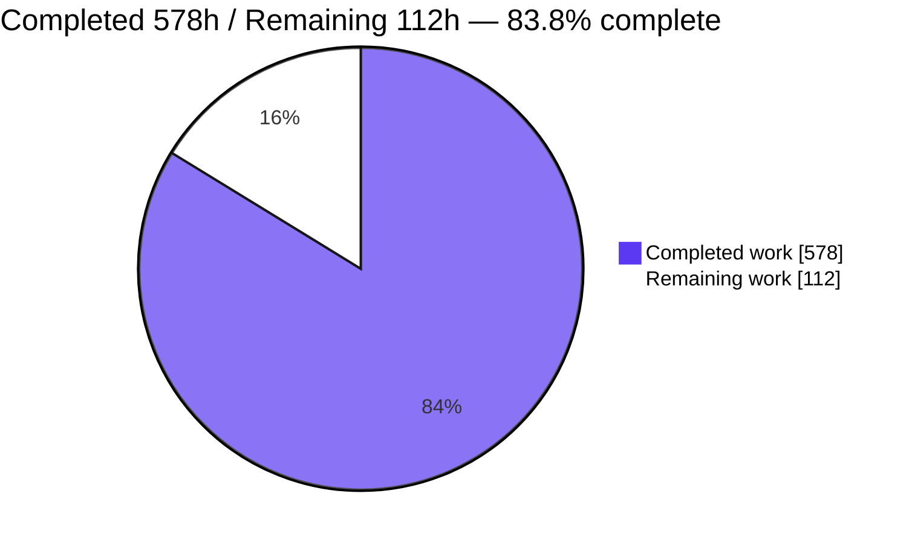
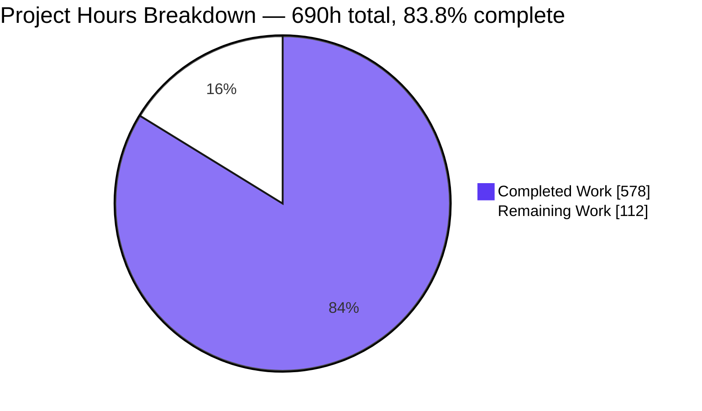

# 1. Executive Summary

A QA sign-off for the replacement of the Mifos X community app: what was built, what was exercised, and what remains.

## 1.1 Project Overview

`web-ng` is the Angular 22 replacement for the legacy AngularJS Mifos X community app. It re-implements the screens staff use daily — sign-in and session handling, the client register and lifecycle, and individual lending from application to repayment — against the same Apache Fineract API, so both front ends can share one backend while screens cut over route by route. A Playwright parity harness drives both through the same workflows.

## 1.2 Completion Status

**Completion: 83.8%** — 578 of 690 scoped hours delivered against the plan's deliverables and the path-to-production work they need.



| Metric | Hours |
|---|---|
| Total Hours | 690 |
| Completed Hours (Baseline: Human with agentic-assist) | 578 |
| Remaining Hours | 112 |

Calculation: `578 ÷ (578 + 112) × 100 = 83.8%`. The completed set is itemised in 2.1; the remaining set, including the Stretch savings workflow the line budget required to be cut, in 2.2.

## 1.3 Key Accomplishments

- Sign-in, session persistence, and a 30-minute idle clock with a warning.
- Permission gating that fails closed across guard, template and service.
- Client register with server search, paging, create, edit and records.
- Five client lifecycle actions behind the legacy datatable gate.
- Lending: schedule preview, edit, five commands, and a three-tab record.
- One interceptor for tenant and credential headers and typed failures.
- A parity harness with masked capture, state snapshots and a report.
- A container image whose entrypoint rewrites runtime configuration.

## 1.4 Critical Unresolved Issues

**14 open items** against the 31 requirements and 12 acceptance criteria the project was scoped to: 5 requirements incomplete, 5 acceptance criteria delivered but not yet executed, and 4 hardening items.

| Issue | Impact | Owner | ETA |
|---|---|---|---|
| **Requirement — savings (W8) not delivered** | The Stretch workflow has no screen, service, route or spec; the cut held the 60,000-line budget | Front-end team | 1 week |
| **Requirement — loan charge payment unexercised** | `pay` needs an account-transfer charge and a loan–savings link the app does not post; `waive`'s happy path was never run | Front-end team | 1 day |
| **Requirement — image and compose stack not executed** | The image cannot resolve the legacy stylesheet here, and the stack has never been brought up | Platform | 2 days |
| **Requirement — difference register is ten readings, not sixteen** | The registered differences are implemented but an item-by-item acceptance table is owed | Front-end team | 0.5 day |
| **Requirement — legacy assets unresolved in the repository** | No locale bundle or image resolves, so every label humanises and brand images 404 | Repository owner | 2 days |
| **Criterion 3 — end-to-end run not executed** | 16 tests collect across both projects; none has run in a fresh environment | QA | 2 days |
| **Criterion 4 — parity has 3 of 8 workflows unverified** | W1 is blocked by the missing locale bundle, W5/W6 by their single-fixture precondition | QA | 2 days |
| **Criterion 9 — legacy integrity unverified** | Needs the legacy app built and served on 9090 beside the new app | QA | 0.5 day |
| **Criterion 10 — compose stack unverified** | Same gap as the image item; the acceptance step has never run | Platform | 0.5 day |
| **Criterion 12 — end-to-end chain not executed** | The chain spec exists and collects; its four-stage run is unproven | QA | 1 day |
| **Hardening — no compression or CSP `script-src`** | Transfers are uncompressed and scripts ship without a content-security policy | Platform | 1 day |
| **Hardening — seed is not idempotent, database shared** | A second seed answers HTTP 403, so parity results depend on external state | Platform | 1 day |
| **Hardening — two behavioural gaps** | The client-edit activation-date message is unassociated; malformed ids are unguarded on three loan routes | Front-end team | 0.5 day |
| **Hardening — design acceptance not performable** | The referenced design frames are absent from the design file | Design / QA | 1 day |

## 1.5 Access Issues

| System/Resource | Type of Access | Issue Description | Resolution Status | Owner |
|---|---|---|---|---|
| Legacy reference app (port 9090) | Build and run a container locally | Must be built for `linux/amd64` and served on 9090 to provide the baseline half of every parity workflow | Open — commands documented in `web-ng/README.md` | QA |
| Design source | Read access to the referenced frames | The frames the plan names are absent from the design file, which holds captures of a different generation | Blocked — needs a usable source, or acceptance against the measured token set | Design |
| Dedicated verification database | Own a PostgreSQL instance and tenant | Verification shares one database with every concurrent checkout, so the reset step cannot run and fixtures collide | Open — needs a per-run database | Platform |
| Backend TLS certificate | Trust a self-signed certificate | Command-line clients need `-k`; browsers must trust it | Worked around — the harness ignores certificate errors | Platform |
| Tenant credentials | Environment-supplied user and password | Read from the environment and never stored in the repository | Provided | Platform |

## 1.6 Recommended Next Steps

1. **[High]** Restore the legacy asset tree into the build context; it closes five open items and unblocks criterion 4's W1.
2. **[High]** Run the full acceptance on a database a single run can own, with the legacy baseline on 9090.
3. **[High]** Decide the savings question: restore the workflow against a re-planned budget, or accept the cut.
4. **[Medium]** Execute the container path end to end and harden the server block in the same pass.
5. **[Medium]** Pin the charge pay and waive paths with a charge-mode fixture.

# 2. Project Hours Breakdown

690 hours are in scope: 578 delivered and verified, 112 remaining. The two tables below account for both halves, and 2.3 states the basis and the confidence behind each figure.

## 2.1 Completed Work Detail

Completed work is itemised by capability, so each row can be traced to the requirement it delivers and to the files that carry it.

| Component | Hours | Description |
|---|---|---|
| Application shell, identity and session | 92 | Sign-in and sign-out against Fineract, the legacy-format session store with its origin binding, session restore through the user endpoint, the idle clock with warning and keepalive, the auth and permission guards, the permission directive, and API-base resolution at start-up (`web-ng/src/app/core/auth`, `core/layout`, `app.config.ts`) |
| HTTP layer and failure handling | 34 | The single functional interceptor that adds the tenant and credential headers, the typed error model with its verbatim-4xx and notice-for-5xx policy, refusal handling, and the notification surface (`web-ng/src/app/core/http`, `core/notifications`) |
| Clients module | 104 | List with pager, server find and display filters; create and edit forms; the record with summary, accounts, identifiers and profile card; and the five lifecycle actions behind the two-call datatable gate (`web-ng/src/app/features/clients`, `core/api/datatable-gate.service.ts`) |
| Loans module | 96 | Application with server-calculated schedule preview, edit, approve, reject, disburse, undo approval, undo disbursal and repayment; the record with schedule, transactions and charges; the charge add, pay and waive screens (`web-ng/src/app/features/loans`) |
| Shared components, search, not-found and shell chrome | 86 | Thirteen shared component triples plus the money, date-format, status-key, submit-guard and translated-label utilities and the permission directive; global search; the not-found screen; breadcrumb, navbar and card chrome (`web-ng/src/app/shared`, `core/api/search.service.ts`, `features/search`, `features/not-found`) |
| i18n and design-system token layer | 58 | Translate composition with the legacy bundle path, the missing-translation handler, the language switcher and reactive label refresh, and the 834-line stylesheet reproducing the legacy Bootstrap 3 token layer over bootstrap-sass and Font Awesome (`web-ng/src/app/core/i18n`, `web-ng/src/styles.scss`) |
| Verification harness | 84 | Seed and reset scripts, backend provenance check, three static gates with `check:all`, the four JSON data files, network capture with credential masking, state snapshots, the parity report in Markdown and JSON, eight Playwright specs with page objects for both front ends, and 106 harness unit tests (`web-ng/e2e`, `web-ng/tools/parity`) |
| Packaging and documentation | 24 | Multi-stage image serving the SPA on 4300, the entrypoint that rewrites runtime configuration, the compose file, the 111-line README and the ignore rules (`Dockerfile.web-ng`, `docker-compose.web-ng.yml`, `web-ng/docker/entrypoint.sh`, `web-ng/README.md`) |
| **Total** | **578** | Equals Completed Hours in 1.2 |

## 2.2 Remaining Work Detail

Remaining work is grouped by the outcome it produces; every group traces to a requirement left incomplete or to the path-to-production work the delivered scope needs.

| Category | Hours | Priority |
|---|---|---|
| Savings workflow (W8) delivery and the line-budget re-plan it requires | 40 | High |
| Legacy asset tree restoration with label and image verification, including the image build's stylesheet input and the strings that currently ship as English literals | 10 | High |
| End-to-end and parity acceptance in a dedicated verification environment, including narrations for the lifecycle forms, re-verification of the wire names against the target backend, the three workflows blocked on environment conditions, and the legacy baseline | 16 | High |
| Container image and compose validation with server-block hardening (compression, CSP `script-src`, missing-asset status) | 12 | High |
| Loan charge pay and waive runtime coverage with a charge-mode fixture | 8 | Medium |
| Residual behavioural gaps: the client-edit activation-date association and malformed-id guards on the loan action, charge-form and repayment routes | 3 | Medium |
| Item-by-item acceptance table for the sixteen registered differences, including the six-key status decision | 2 | Medium |
| Design acceptance re-planned against a usable design source | 4 | Medium |
| Seed idempotency, or a dedicated verification database per run | 6 | Medium |
| CI pipeline wiring every gate and release automation | 11 | Medium |
| **Total** | **112** | Equals Remaining Hours in 1.2 and the Remaining Work slice in Section 7 |

## 2.3 Estimation Basis and Confidence

Hours are engineering hours, not elapsed time. Completed figures are anchored to what the tree contains — 59,922 lines across 257 files, 85 spec files and 1,686 executed tests — using the per-capability rates the assessment applies throughout: simple form or list work 8–16 hours per entity, a complex business module 24–40 hours, a third-party integration path 16–24 hours, and test effort at 30–40% of development effort.

Remaining figures are conservative where the work is least defined. Confidence is **high** for the asset-tree restoration (10h), the residual behavioural gaps (3h) and the acceptance table (2h): each is bounded by files that already exist. It is **medium** for the acceptance run (16h), the image path (12h) and the charge-mode fixture (8h), where environment behaviour decides the effort. It is **low** for the savings restoration (40h), which must first settle how a fifth feature fits a 60,000-line budget already spent to 59,922, and for CI (11h), which depends on the pipeline the organisation standardises on.

Two figures carry explicit uncertainty worth naming: the savings estimate assumes the recorded cut (17 files, 5,214 lines) can be re-landed largely as it stood — if the budget cannot absorb it, the re-plan becomes a scope negotiation rather than an implementation task — and the acceptance estimate assumes a database that one run can own; if it cannot, the three environment-blocked workflows stay blocked and the estimate is unbounded.

# 3. Test Results

Everything in this section was executed on the delivered tree; the counts are the runs' own totals.

| Area / Category | Framework | Tests | Passed | Failed | Coverage | What This Proves |
|---|---|---|---|---|---|---|
| Application behaviour — screens, shared components, guards, pipes, routes | Vitest 5.1.1 + jsdom through the Angular unit-test builder | 1,327 | 1,327 | 0 | 96.14% statements / 96.82% lines (gate 65%) | Every screen renders and responds as specified, including failure, empty and not-found states, under strict templates |
| Services and the Fineract contract | Vitest 5.1.1 through the same builder | 253 | 253 | 0 | 100% statements / 100% lines (gate 90%) | Every call is issued with the exact method, path, query parameters, body and date grammar, and every error is mapped to the typed model |
| Verification harness — capture, snapshots, seed fixtures, register, report writer | Vitest 5.1.1 | 106 | 106 | 0 | 72.12% statements / 72.37% lines | Captures mask credentials, role tokens normalise identically for both front ends, snapshots and the report writer behave, and the seed's payloads are correct |
| Static contract gates — endpoint allowlist, template coverage, wiring | Three TypeScript gates run by `npm run check:all` | 3 gates | 3 | 0 | 43 allowlisted endpoints; 12 of 12 templates covered; 85 of 85 specs assert | No request outside the allowlist, no in-scope endpoint left uncalled, no dead injectable or route drift, no credential literal, no file outside the write boundary |

The production build and the lint pass are gates rather than tests: both exit 0, with the initial bundle at 563.90 kB raw and 128.55 kB transfer against a 1.5 MB budget, and the only build output beyond success is six stylesheet import deprecations.

**Not Covered** — capabilities delivered but not exercised by any test, and what to test by hand before release:

- **End-to-end and parity workflows** — 16 tests across 8 specs and 2 projects collect but none has been executed against a fresh database with the legacy app running; three of the eight workflows are blocked by environment conditions rather than by defects.
- **The client lifecycle and lending workflows end to end on both front ends** — the chain that creates a client, submits a loan, approves and disburses it and repays it exists as a spec, and its four stages have not been run in sequence.
- **Container image build and compose stack** — the image's assertions and the served container have never been exercised; the entrypoint's configuration rewrite was verified only against a copy of the served file.
- **Loan charge payment and waiver happy paths** — the pay command is unreachable on the seeded product (it needs an account-transfer charge and a loan–savings link the app does not post) and waiver's success path was never run.
- **Undo-approval and undo-disbursal against a live loan** — the commands and their date-less bodies are covered by contract tests, but no runtime run reversed a loan.
- **Legacy label and image resolution** — with no legacy asset tree in the repository, no locale bundle or image is served, so translation resolution was never observed; labels render humanised.
- **Idle timeout at real scale** — the 30-minute idle, 10-second warning and keepalive are proven with a virtual clock, not by waiting.
- **Database reset and a repeat seed** — the reset path cannot run against a shared instance, and a second seed is known to fail on its duplicate staff name.
- **Design pixel acceptance** — the referenced design frames are not in the design file, so no screenshot comparison against them was performed.

# 4. Runtime Validation & UI Verification

The application was served locally and driven through a real browser against a live Fineract backend, with credentials read from the environment and never written to output.

- ✅ **Start-up and configuration** — the login screen loads with the eight-key runtime configuration served from `web-ng/src/assets/config.json`, 13 languages offered, and no JavaScript exception.
- ✅ **Authentication and session** — exactly one authentication request per sign-in; an unauthenticated deep link lands on the login screen with the attempted URL preserved; sign-out empties storage and the guard re-arms on the next navigation.
- ✅ **Clients list** — 15 rows, a pager with first, previous, next and last controls, and 15 text-free status swatches; boundary navigation reads one page at a time and a disabled control issues no request.
- ✅ **Client record** — breadcrumb, record header, two tabs, summary and performance rows, and an account table of 18 rows on one client and 7 on another; the identifier tab shows its explicit empty state.
- ✅ **Client lifecycle forms** — an empty close-client submission marks both controls invalid and posts nothing.
- ✅ **Global search** — a navbar query lands on the scoped search screen and renders the matching client row with its client number and office.
- ✅ **Loan record** — header with account number, client and principal, five summary figures, three tabs, and a 13-row, 9-column repayment schedule.
- ✅ **Loan application** — the template-driven product list populates (12 selects and 8 inputs on the screen) and the schedule preview mounts.
- ✅ **Not-found handling** — a malformed loan identifier and an unknown route both render the not-found presentation, and the malformed identifier issues no request.
- ⚠ **Legacy translations and images** — four asset requests answer 404 because the repository carries no legacy asset tree; labels render humanised ("Clientno", "Nodata") and the brand images are missing.

Never exercised at runtime: the end-to-end and parity workflows on either front end, the container image and compose stack, loan charge payment and waiver, undo-approval and undo-disbursal, the savings workflow (not delivered), and any translation resolution from the legacy bundles.

# 5. Compliance & Quality Review

The delivered capabilities are measured against the quality and compliance benchmarks the project was scoped to: security of credential handling and authorisation, API fidelity, functional completeness of each scope band, testability, deployability, code standard, internationalisation, credential hygiene and size governance. 5.1 shows where each stands now; 5.2 records every place the delivery departs from the plan or the user's rules, and why.

## 5.1 Compliance Matrix

| Deliverable | Benchmark | Status Now | Evidence |
|---|---|---|---|
| Sign-in, session lifecycle and idle handling | Security — credential handling and session lifetime | ✅ PASS | 21 auth and 10 idle-clock tests; live sign-in, sign-out and guard re-arm (`web-ng/src/app/core/auth`) |
| Permission model | Security — authorisation fails closed | ✅ PASS | Permission, guard and directive specs; all-functions and read wildcards and `!` inversion (`web-ng/src/app/core/auth/permissions.service.ts`) |
| Request contract | API fidelity — one allowlisted endpoint per call, none invented | ✅ PASS | Endpoint gate 0 violations over 43 entries; 253 service tests asserting method, path, parameters and body |
| Client register and lifecycle | Functional completeness — Must scope | ✅ PASS | List, pager, find, create, edit, record and five lifecycle actions; verified in a live session (`web-ng/src/app/features/clients`) |
| Individual lending | Functional completeness — Must scope | ⚠ PARTIAL | Application, edit, record, schedule, transactions and five commands verified; charge payment and waiver unexercised (`web-ng/src/app/features/loans`) |
| Savings workflow | Functional completeness — Stretch scope | ❌ NOT DELIVERED | Removed to hold the line budget; no screen, route, service or spec remains |
| Verification harness | Testability — parity evidence for both front ends | ⚠ PARTIAL | Eight specs with both page-object sets, capture masking, snapshots and the report; the parity run awaits a clean environment |
| Packaging and deployment | Deployability | ⚠ PARTIAL | Image definition, entrypoint rewrite, compose file and documentation delivered; the stack has not been brought up |
| Code standard | Strict TypeScript, typed models, clean lint | ✅ PASS | Build and lint exit 0; `any` confined to documented boundaries; typed request/response model per family |
| Internationalisation and accessibility | Every label translatable; semantic landmarks | ⚠ PARTIAL | Translation path, handler and 13-language switcher in place; resolution from the legacy bundles unobservable, and six accessible names are literals |
| Credential hygiene | No secrets in source; environment-only reads | ✅ PASS | Zero credential literals found by the wiring gate; masked captures; credentials read from the environment |
| Size governance | Line and bundle budgets respected | ✅ PASS | 59,922 of 60,000 generated lines; 563.90 kB of a 1.5 MB initial bundle |

## 5.2 AAP & Rule Divergences and Gaps

| What the AAP/Rule Required | What Was Delivered Instead | Why It Diverged | Impact | Remediation |
|---|---|---|---|---|
| Savings workflow delivered (plan §0.9.1, item 4 — Stretch) | Not delivered: 17 files and 5,214 lines removed, including three screens, the service, models, routes, both page objects and the W8 spec; the allowlist fell from 51 to 43 entries | The tree measured 88,418 lines against a 60,000 ceiling, and the plan's own cut order drops Stretch first and stops there | No savings capability and no W8 parity record | Restore against a re-planned budget — 40h |
| Legacy stylesheet imported from `app/styles-dev/main` (Rule 1 clause 6; plan §0.8.2) | The legacy partials are reproduced inline in `web-ng/src/styles.scss` (834 lines) | The repository carries no legacy tree, so the import is a build error; the plan authorises inline reproduction in exactly that case | Styling no longer tracks the legacy partials automatically | Restore the import where the tree exists — part of the 10h |
| Translations and images referenced in place from `app/` (Rule 1 clause 6) | `web-ng/angular.json` declares the inputs and a tracked `web-ng/app -> ../app` symlink exists, but the tree is absent, so no locale bundle or image is served | Repository content, not a code choice | Labels humanise, four asset requests 404, and the image build cannot resolve the stylesheet | Restore the tree — 10h (release-blocking) |
| Status vocabulary fixed at four keys (plan §0.2.3, §0.7.1) | Six keys — `active`, `pending`, `closed`, `rejected`, `withdrawn`, `other` — with two added colour tokens (#d9534f, #800080) | Plan §0.5.4 requires the legacy status classes including rejected and withdrawn, and §0.10.5 item 11 forbids a status word; four keys cannot tell them apart | Two extra tokens to maintain; the indicator stays colour-only | Amend the props to six keys, or accept as delivered |
| Error model of three members and no request legacy does not make (plan §0.7.1; Rule 1 clause 2) | A fourth `timedOut` member, and status 0 treated as a suspected credential refusal with one extra user read | On cross-origin calls Fineract's 401 escapes the CORS filter and reaches the browser as status 0 | One extra read on a suspected refusal; an outage is not mistaken for a refusal | None required — documented at the code |
| Clear the session and redirect on any failed call (plan §0.4.2) | The session clears only when a refusal is actually observed | A transport failure must not discard the session the legacy screens share (Rule 1 clause 3) | A slow backend no longer signs the user out | None required — documented at the code |
| Form dates from the tenant business date (Rule 1 clause 2) | Form defaults come from the browser clock; the harness derives the run date from the business date | The plan registers this deliberately (§0.10.5 item 15) because an in-app business-date read adds a request to every workflow | A date-bearing submit is refused when the tenant date differs from the host clock — two days on this deployment | None required — the harness owns the run date |
| No client-side validation legacy lacks (Rule 1 clause 3) | Required validators and a pre-submit refusal on the lifecycle forms | The plan authorises carrying the legacy required rules into the new forms (§0.4.4 decision 6) | With no narrations configured, the close, reject and withdraw forms cannot submit where the legacy app posted and showed Fineract's message | Configure narrations in the verification environment |
| Wire members named as the plan's model rows (plan §0.7.2) | `approvedLoanAmount`, `transactionProcessingStrategyCode`, a dated reactivate body, client edit without `officeId`, and the charge row `{id?, chargeId, amount, dueDate?}` | The backend refuses the plan's names with HTTP 400, and the plan makes the running server the contract (§0.7.3) | Correct against this backend; a backend built to the plan's model rows would refuse the bodies | Verify against the target backend before cutover |
| Every API URL in the application allowlist (Rule 1 clause 2) | Seven server-root URLs live in the harness allowlist instead | The application allowlist must remain a true statement about the application (plan §0.10.4) | None | None |
| Every label from the legacy bundles (Rule 1 clause 6; plan §0.10.2) | Six accessible names, the skip-link text, the session-expiry sentence and the clients card title are English literals | No legacy bundle carries a key for them, and the legacy tree may not be edited | Those strings do not follow the language switcher | Add keys once the bundles are authoritative — 0.5 day |
| No tenant data in source (Rule 1 clause 9) | `tenantId: "default"` ships in `web-ng/src/assets/config.json` | The plan keeps the tenant identifier outside the credential gate (§0.10.4 — it selects a tenant rather than describing one) | None | None |
| Sixteen deliberate differences each registered with a reason (plan §0.10.5) | Ten register readings covering the narrowings, the cut and the copy the application owns; the sixteen are implemented as behaviour | The register documents where the tree reads an item more narrowly rather than restating items it implements as written | An item-by-item acceptance table is still owed | Produce the table — 2h |
| Server block exactly as specified (plan §0.8.2) | The SPA fallback answers a missing asset with 200 and the index page; no compression and no CSP `script-src` | The plan prescribes this block verbatim and Rule 1 clause 3 forbids improving on the legacy app | Missing assets are masked, transfers are uncompressed, scripts have no policy | Harden in the packaging pass — 12h |
| Gate scripts about 600 lines and a report writer of 300–450 lines (plan §0.11.1 sizing) | 1,479 gate lines and a 1,194-line report writer | The mandated checks and report sections did not fit the guidance at the documented depth; the binding limit is the 60,000-line ceiling | More code to maintain than estimated | None |
| Loan charge payment exercised (plan §0.9.1 item 3) | Implemented and contract-tested, but payment is unreachable on the seeded product and waiver's success path was never run | Paying needs an account-transfer charge and a loan–savings link the application does not post | The charge-payment surface rests on contract tests alone | Charge-mode fixture and specs — 8h |

**Savings (row 1) — 40 hours, and a decision rather than a task.** The removal is clean and deliberately recorded: `web-ng/src/app/features/savings` is gone, `web-ng/e2e/specs` holds eight specs and none of them is W8, and `web-ng/tools/parity/endpoint-allowlist.json` carries 43 rows with the eight savings endpoints struck and the removal named in its header. The reason the cut stands is arithmetic: the restored half measures 5,214 lines and the tracked tree already measures 59,922 of a 60,000 ceiling, so re-landing it as it stood would put the project at roughly 64,451 lines. The open question for the owner is therefore not "how" but "what gives" — a larger ceiling, a smaller parity suite, or acceptance of the cut as final scope.

**Legacy assets (row 3) — 10 hours, and the one item that explains the most visible symptoms.** The wiring is right and the files are absent: `web-ng/angular.json` maps `app/global-translations` and `app/images`, `web-ng/app` is a tracked relative symlink to `../app` so the builder can read a tree that lives outside the workspace root, and `web-ng/src/styles.scss` documents that its legacy layer is a reproduction because the original cannot be imported from a checkout that does not carry it. In this repository every locale and image request answers 404, so labels render humanised and the brand imagery is missing; the container build fails at its `COPY` of the legacy stylesheet for the same reason. Restoring `app/` into the build context closes all of it, including criterion 4's W1.

**Server block and packaging (row 14) — 12 hours.** `Dockerfile.web-ng` and `web-ng/docker/entrypoint.sh` are complete and the rewrite they perform is verified: given `API_BASE_URL` and `TENANT_ID`, exactly those two keys change and the other six stay byte-identical, and a non-HTTP value is refused with a non-zero exit. What remains is the run: the image has never been built to completion here, the compose stack has never been brought up, and the server block the plan prescribes carries no compression, no CSP `script-src`, and a `try_files` fallback that answers a missing asset with a 200 and the index page. Those three gaps are the difference between a stack that starts and a stack that is observable and safe to expose.

**Wire members (row 9) — verification, not rework.** Five request shapes follow the backend rather than the plan's model rows because the backend refuses the plan's names outright: approval posts `approvedLoanAmount` (the plan says `approvedPrincipal`), the loan application posts `transactionProcessingStrategyCode`, reactivation carries a required date, client edit omits `officeId`, and a charge row is `{id?, chargeId, amount, dueDate?}`. Each is pinned by a contract test and each is defensible against this backend, but the project's correctness depends on the target backend accepting the same names, so the check belongs in cutover planning rather than in the code.

**Narrations and empty lifecycle forms (row 8) — a configuration dependency.** The lifecycle forms require a reason, which is what the legacy forms mark with an asterisk. The legacy app posted an empty reason and let the server refuse it; this application refuses first, which is safe but only useful if a narration exists to pick. The verification tenant has none registered, so close, reject and withdraw cannot be submitted until the seed creates the narrations the same seed already knows how to create per action code. That is an environment task with a one-hour cost, and it gates the lifecycle half of any end-to-end run.

**Difference register (row 13) — 2 hours.** `web-ng/e2e/report/difference-register.ts` documents ten readings: the savings cut, the form date defaults, the charge-action vocabulary and the unreachable payment path, the client-template read, the application-owned copy, and the failure and accessibility behaviours the plan does not name. A reader working through the plan's sixteen items will find some implemented as written and therefore absent from the register, which is coherent but not what an item-by-item acceptance pass expects. Producing the sixteen-row table from the register plus the code comments closes the gap with no behavioural change.

# 6. Risk Assessment

| Risk | Category | Severity | Probability | Mitigation | Status |
|---|---|---|---|---|---|
| The savings workflow is absent, so any client expecting savings screens finds none | Technical / scope | High | Certain | Restore the workflow against a re-planned line budget, or record the cut as accepted scope with its revised totals | Open |
| The repository carries no legacy asset tree, so a build from it serves no labels or images and the image build cannot resolve the legacy stylesheet | Integration | High | Certain | Restore `app/` into the build context before packaging; the wiring and the symlink are already in place | Open |
| End-to-end and parity acceptance has never run against a fresh single-fixture database, and three workflows fail on environment conditions rather than defects | Operational | High | High | Run the full suite in a dedicated environment: reset, seed, both projects, chain, legacy baseline on 9090 | Open |
| Charge payment and waiver are implemented but unexercised | Technical | Medium | Medium | Build a charge-mode fixture (account-transfer charge plus a loan–savings link) and pin both paths with specs | Open |
| The server block serves uncompressed and without a CSP `script-src`, and masks a missing asset with a 200 index page | Security / operational | Medium | Medium | Add compression, a script policy and an asset-status rule in the packaging pass | Open |
| Verification depends on a database every concurrent run writes to, and the seed is not idempotent | Operational | Medium | High | Provision a database per run, or make the seed idempotent on its staff and product names | Open |
| Several wire members follow this backend's accepted names, so a backend built to the plan's model rows would refuse the bodies | Integration | Medium | Low | Keep the per-endpoint contract tests as the record and re-verify every body against the target backend before cutover | Open |
| Design acceptance cannot be performed: the referenced frames are absent from the design file, which holds captures of a different generation | Operational / quality | Medium | Medium | Re-plan acceptance against a usable source, or accept the measured token set the plan fixes | Open |

# 7. Visual Project Status



Remaining hours by category, the same figures as Section 2.2:

| Category | Hours | Priority |
|---|---|---|
| Savings workflow (W8) delivery and line-budget re-plan | 40 | High |
| Legacy asset tree restoration and verification | 10 | High |
| End-to-end and parity acceptance run | 16 | High |
| Container image, compose validation and server hardening | 12 | High |
| Loan charge pay and waive coverage | 8 | Medium |
| Residual behavioural gaps | 3 | Medium |
| Difference acceptance table | 2 | Medium |
| Design acceptance re-plan | 4 | Medium |
| Seed idempotency or dedicated database | 6 | Medium |
| CI pipeline and release automation | 11 | Medium |
| **Total remaining** | **112** | 4 High (78h), 6 Medium (34h) |

Priority distribution: 78 hours are release-blocking (70% of the remaining work) and 34 hours are pre-production hardening; no low-priority polish is outstanding, because the line ceiling leaves no room for work the acceptance criteria do not require.

# 8. Summary & Recommendations

The delivered tree is a working replacement front end for the Must-scope half of the migration: 59,922 lines across 257 files, 85 spec files, and 1,686 passing tests plus three static gates and a production build that fits its budget at 563.90 kB of 1.5 MB. Sign-in, session and idle handling, the client register and lifecycle, individual lending from application to repayment, global search, permission gating and the single HTTP path were all exercised in a live browser against a real Fineract backend as well as through their unit tests. The verification harness — seed, database reset, backend provenance, capture with credential masking, state snapshots and a Markdown plus JSON parity report — is complete and its own 106 tests pass. On the plan's own accounting this is **83.8% complete: 578 hours delivered of 690 scoped**.

| Measure | Value |
|---|---|
| Scoped completion | 83.8% (578 of 690 hours) |
| Tests executed and passing | 1,686 of 1,686 across three projects |
| Statement and line coverage | 96.14% / 96.82% (gate 65%) and 100% / 100% (gate 90%) |
| Generated lines | 59,922 of a 60,000 ceiling |
| Initial bundle | 563.90 kB of a 1.5 MB budget |
| Open items | 14 of 43 scoped requirements and acceptance criteria |

What remains divides into three kinds of work, and only one of them is code. The largest single block, 40 hours, is the savings workflow the line budget required to be cut — a scope decision for the owner rather than a defect, because restoring it as it stood would put the tree roughly 4,450 lines over the ceiling the plan fixes. The second block, 26 hours, is environment work that no amount of code can substitute for: a database a single run can own, the legacy app served beside the new one, the legacy asset tree present in the build context, and the acceptance run that turns collected tests into evidence. The third, 46 hours, is finishing work of known shape — the container path and its server hardening, charge-mode fixtures, two behavioural gaps, the difference acceptance table, design acceptance re-planning and CI.

The critical path to production runs through the legacy asset tree first, because it is the one item whose absence is visible on every screen and in the container build, and through the acceptance run second, because it converts 16 collected tests and a three-fifths-complete parity result into the evidence a release decision needs. Packaging comes third: the image definition and configuration rewrite are verified in isolation, so what is missing is the run itself plus the compression and script policy a public deployment requires.

Production readiness, stated plainly: the application is ready for a controlled pilot on a screen-by-screen cutover, not for a full replacement. Its Must-scope screens are verified, its failure handling is consistent, its credential hygiene is clean, and its budgets are met; but five acceptance criteria rest on runs that have not happened, the savings workflow is absent, and the deployment has never been exercised as a stack. Closing the 78 release-blocking hours removes every one of those caveats except the savings decision, which the owner settles by choosing between a larger budget, a narrower parity suite and final acceptance of the cut.

# 9. Development Guide

### Prerequisites

| Requirement | Version used and verified |
|---|---|
| Node.js and npm | Node 22.23.5 (floor `>=22.22.3`), npm 11.21.3 |
| A JDK, for the Fineract backend | 25 (Temurin) |
| PostgreSQL | 16 or newer; the backend creates `fineract_tenants` and `fineract_default` |
| Playwright Chromium | Installed once with `npx playwright install chromium`; the harness drives it headlessly |
| Docker with Compose | Only for the packaging path |
| A POSIX shell | Every script runs unchanged on macOS and Linux |

### Repository layout

| Path | Contents |
|---|---|
| `web-ng/src/app/core` | Auth and session, layout shell, HTTP interceptor and error model, configuration, i18n, notifications, search and the datatable gate |
| `web-ng/src/app/shared` | Reusable components (date and select fields, status swatch, data table, empty state, notification, panel card, record-not-found, language switcher, tab strip) and the date, money, status and submit utilities |
| `web-ng/src/app/features` | The screens: `auth`, `clients`, `loans`, `search`, `not-found`, each with its own route array |
| `web-ng/e2e` | Playwright configuration, page objects for both front ends, network capture, state snapshots, seed and reset, the report writer and the eight specs |
| `web-ng/tools/parity` | The three static gates, their shared library and the four JSON data files that define the contract |
| `Dockerfile.web-ng`, `docker-compose.web-ng.yml` | The packaging path, built from the repository root |

### Environment variables

| Variable | Used by | Purpose |
|---|---|---|
| `FINERACT_BASE_URL` | Seed, harness, page objects | API base, default `https://localhost:8443/fineract-provider/api/v1` |
| `FINERACT_TENANT_ID` | Same | Tenant header value, default `default` |
| `FINERACT_USERNAME` / `FINERACT_PASSWORD` | Login and harness | Credentials, read at run time and never stored |
| `E2E_USER` / `E2E_PASSWORD` | Seed and Playwright | Optional aliases; the harness reads either pair |
| `FINERACT_COMMIT` | `npm run check:backend` | The backend revision the run must be pinned to |
| `LEGACY_URL` / `NEXT_URL` | Playwright projects | Defaults `http://localhost:9090` and `http://localhost:4300` |
| `API_BASE_URL` / `TENANT_ID` | Container entrypoint | Rewrite the served configuration at start-up |
| `CODESPACES` | Backend check | Records the run environment; unset means a local machine |

```bash
cd web-ng
set -a; . ./.env.local; set +a          # optional: E2E_USER and E2E_PASSWORD from a git-ignored file
read -rs E2E_PASSWORD && export E2E_PASSWORD   # or type it without echo and without shell history
```

### Install, build, lint and test

```bash
cd web-ng
npm install            # never npm ci: no lockfile is committed and every dependency is pinned exactly
npm run build          # production build; fails above a 1.5 MB initial bundle
npm run lint           # zero findings expected
npm test               # two coverage passes: web-ng (65% gate) then web-ng-services (90% gate)
```

Expected results on a clean checkout: the build reports an initial total around 564 kB, lint prints "All files pass linting", and the two test passes report roughly 1,327 and 253 tests with no failures. Six stylesheet import deprecation warnings from the Bootstrap, Font Awesome and legacy layers are expected and do not fail the build.

### Static gates and harness checks

```bash
cd web-ng
npm run check:endpoints        # every API URL is allowlisted; no demo host anywhere in the tree
npm run check:templates        # every in-scope legacy template endpoint is called by a service
npm run check:wiring           # no dead injectable or route drift, no spec without an assertion, no credential literal, no file outside the write boundary
npm run check:all              # the three above, in order
npm run typecheck:harness      # tsc over e2e/ and tools/, the trees the application build never type-checks
npm run test:harness           # the harness unit suite (8 files, 106 tests)
```

### Backend

Build and run the Fineract fork from source. Keep the clone outside this repository; the front end never writes to it.

```bash
cd "$FINERACT_HOME"
git checkout "$FINERACT_COMMIT"
./gradlew :fineract-provider:bootJar -x test --console=plain

service postgresql start
export FINERACT_NODE_ID=1 FINERACT_SERVER_SSL_ENABLED=true SPRING_PROFILES_ACTIVE=test,diagnostics
export FINERACT_HIKARI_JDBC_URL=jdbc:postgresql://localhost:5432/fineract_tenants
export FINERACT_HIKARI_USERNAME=postgres FINERACT_HIKARI_PASSWORD="$FINERACT_DB_PASSWORD"
export FINERACT_DEFAULT_TENANTDB_HOSTNAME=localhost FINERACT_DEFAULT_TENANTDB_PORT=5432
export FINERACT_DEFAULT_TENANTDB_UID=postgres FINERACT_DEFAULT_TENANTDB_PWD="$FINERACT_DB_PASSWORD"
export FINERACT_DEFAULT_TENANTDB_NAME=fineract_default FINERACT_DEFAULT_TENANTDB_IDENTIFIER=default
export FINERACT_DEFAULT_MASTER_PASSWORD="$FINERACT_MASTER_PASSWORD"
java --add-opens=java.base/java.lang=ALL-UNNAMED -Xmx2G \
  -jar fineract-provider/build/libs/fineract-provider-0.1.0-SNAPSHOT.jar
```

Wait for health, then confirm the run is pinned to the expected build:

```bash
curl -sk https://localhost:8443/fineract-provider/actuator/health        # {"status":"UP",...}
cd web-ng && npm run check:backend                                      # names the fork and its commit
```

### Run the application

```bash
cd web-ng
npx ng serve --port 4300 --host 0.0.0.0
# open http://localhost:4300/ and sign in; the hash routes are e.g. #/login, #/clients, #/viewclient/2
```

Configuration is resolved in three steps, the last winning: `web-ng/src/assets/config.json` (eight keys, including `apiBaseUrl` and `tenantId`); the container entrypoint rewriting those two keys from `API_BASE_URL` and `TENANT_ID`; and `?baseApiUrl=…&tenantIdentifier=…` on the page URL.

### Seed, reset and the parity suite

```bash
cd web-ng
npm run seed                   # fixtures on an existing backend; not idempotent
npm run reset:db               # drop, recreate, wait for health, then seed; own the database before running it
npm run e2e                    # provenance check, capture retention, legacy project, next project, report
```

`npm run e2e` needs the legacy app on 9090 and the new app on 4300, and it writes `parity-report.md` and `parity-report.json` plus `e2e/.captures/`, all git-ignored. To run one project only:

```bash
NEXT_URL=http://localhost:4300 npx playwright test --config=e2e/playwright.config.ts --project=next
npx playwright test --list     # collects 16 tests in 8 files across both projects
```

### Packaging

```bash
# from the repository root: the Dockerfile's COPY sources and the compose build context are relative to it
docker build -f Dockerfile.web-ng -t web-ng .
docker compose -f docker-compose.web-ng.yml up -d
# open http://localhost:4300/: the entrypoint has rewritten assets/config.json from the environment
```

### Verify the setup

1. `npm run build && npm run lint && npm test` all exit 0.
2. `npm run check:all` and `npm run typecheck:harness && npm run test:harness` all exit 0.
3. `npm run check:backend` names the Fineract fork and the expected commit.
4. `http://localhost:4300/#/login` renders the sign-in form, and signing in with the tenant credentials lands on `#/clients` with rows and a pager.
5. `npx playwright test --list` collects 16 tests in 8 files.

### Troubleshooting

| Symptom | Cause and resolution |
|---|---|
| `This command is not available when running the Angular CLI outside a workspace` | The command was run outside `web-ng/`; every `npm` and `ng` command runs from that directory |
| Labels render as humanised words ("Clientno", "Nodata") and brand images are broken | The legacy asset tree is not in the build context, so `global-translations/` and `images/` are not served; build where the repository root holds `app/` (the tracked `web-ng/app` symlink is what lets the builder read it) |
| Build fails resolving `app/styles-dev` or `app/global-translations` | Same cause; the image build asserts on those inputs rather than degrading |
| Six `@import` deprecation warnings during a build | Expected from the Bootstrap, Font Awesome and legacy layers; they do not fail the build |
| `check:backend` reports an unexpected build or commit | The backend is not the fork at `FINERACT_COMMIT`; rebuild and restart it from source |
| `npm run seed` answers HTTP 403 "A staff with the given display name 'Officer, Parity' already exists" | The seed is not idempotent; run it against a database you own, or rename the fixtures |
| Playwright fails its single-fixture precondition ("Examined 0 account row(s)") | The database holds other runs' fixtures; reset a database you own before the run |
| W1 fails on the language switch with a form error | The locale bundle answers 404 (see the asset-tree row above), so the switch never completes |
| A date-bearing form is refused although the dates look right | The tenant business date differs from the host clock and the forms default from the browser clock; correct the date before submitting |
| `curl` or the browser rejects the backend certificate | It is self-signed; use `curl -k` and trust the certificate, and the harness already ignores certificate errors |
| `reset:db` drops data you did not intend to lose | It recreates the tenant databases; never run it against a shared instance |

# 10. Appendices

### A. Command Reference

| Command (from `web-ng/` unless noted) | What it does |
|---|---|
| `npm install` | Installs the pinned dependencies; writes a git-ignored lockfile |
| `npm run build` | Production build into `dist/web-ng/browser`, failing above a 1.5 MB initial bundle |
| `npm run lint` | ESLint with the Angular, TypeScript and template rule sets |
| `npm test` | Both coverage passes: `web-ng` (65% gate) then `web-ng-services` (90% gate) |
| `npm run check:endpoints` | Endpoint allowlist, invented-URL and demo-host gate |
| `npm run check:templates` | Template coverage and allowlist cross-check |
| `npm run check:wiring` | Dead code, route drift, spec discipline, credential literals, write boundary |
| `npm run check:all` | The three gates in order |
| `npm run typecheck:harness` | Strict compile of `e2e/` and `tools/` |
| `npm run test:harness` | Harness unit suite with coverage |
| `npm run check:backend` | Asserts the backend is the expected fork at the expected commit |
| `npm run seed` / `npm run reset:db` | Fixtures on an existing backend / recreate and seed the databases |
| `npm run e2e` | Provenance, capture retention, both Playwright projects, parity report |
| `npx playwright test --list` | Collects 16 tests in 8 files without running them |
| `npx ng serve --port 4300 --host 0.0.0.0` | Development server |
| `docker build -f Dockerfile.web-ng -t web-ng .` / `docker compose -f docker-compose.web-ng.yml up -d` | Packaging path, run from the repository root |

### B. Port Reference

| Port | Service |
|---|---|
| 4300 | The application (development server and the container's published port) |
| 8443 | Fineract API over HTTPS with a self-signed certificate |
| 9090 | The legacy application, needed by the parity baseline |
| 5432 | PostgreSQL for the backend |
| any free port | A second development server, for example to compare two builds side by side |

### C. Key File Locations

| Concern | File |
|---|---|
| Route tree and access codes | `web-ng/src/app/app.routes.ts`, `web-ng/src/app/features/*/*.routes.ts` |
| Start-up composition (configuration, session restore, translation, router) | `web-ng/src/app/app.config.ts` |
| Runtime configuration defaults | `web-ng/src/assets/config.json` |
| Session format and storage | `web-ng/src/app/core/auth/session.service.ts` |
| Interceptor and error model | `web-ng/src/app/core/http/fineract.interceptor.ts`, `api-error.ts` |
| Permission algebra | `web-ng/src/app/core/auth/permissions.service.ts` |
| Status vocabulary and money formatting | `web-ng/src/app/shared/status-key.util.ts`, `money/money.pipe.ts` |
| Global stylesheet and design tokens | `web-ng/src/styles.scss` |
| Endpoint contract data | `web-ng/tools/parity/endpoint-allowlist.json`, `harness-allowlist.json`, `in-scope-routes.json` |
| Registered differences | `web-ng/e2e/report/difference-register.ts` |
| Container configuration rewrite | `web-ng/docker/entrypoint.sh` |
| Operating instructions | `web-ng/README.md` |

### D. Technology Versions

| Package | Version |
|---|---|
| Angular (`@angular/*`, CLI and build) | 22.3.0 |
| TypeScript | 6.0.3 |
| Node.js | `>=22.22.3` (verified on 22.23.5) |
| RxJS / tslib | 7.8.2 / 2.9.1 |
| `@ngx-translate/core` / `http-loader` | 18.1.0 / 18.1.0 |
| Bootstrap (Sass) / Font Awesome | 3.4.3 / 4.7.0 |
| Vitest / jsdom / coverage provider | 5.1.1 / 31.0.1 / 5.1.1 |
| Playwright | 1.65.1 |
| ESLint / angular-eslint / typescript-eslint | 9.39.5 / 22.8.0 / 8.73.0 |
| tsx / `@types/node` | 4.23.15 / 22.20.5 |

### E. Runtime Configuration Reference

`web-ng/src/assets/config.json` carries eight keys; the container entrypoint rewrites the first and third, and every other key is served unchanged.

| Key | Default | Meaning |
|---|---|---|
| `apiBaseUrl` | `https://localhost:8443` | Backend origin; rewritten from `API_BASE_URL`, overridable with `?baseApiUrl=` |
| `apiPath` | `/fineract-provider/api/v1` | API path appended to the origin |
| `tenantId` | `default` | Tenant header; rewritten from `TENANT_ID`, overridable with `?tenantIdentifier=` |
| `dateFormat` | `dd MMMM yyyy` | Date grammar every request body is written with |
| `locale` | `en` | Starting language, replaced at run time by the user's choice |
| `idleMinutes` | `30` | Idle window before sign-out |
| `warningSeconds` | `10` | Warning shown before the idle window closes |
| `keepaliveMinutes` | `15` | Interval of the local heartbeat; it issues no request |

### F. Developer Tools Guide

| Tool | What it protects against | When to run |
|---|---|---|
| `check:endpoints` | A request to an unlisted or invented URL, a demo host anywhere in the tree, and a URL literal outside the allowlists | On every change that touches a service, page object or data file |
| `check:templates` | An in-scope endpoint the application never calls, and allowlist drift between the gate and the data | On every service change |
| `check:wiring` | A component or injectable nothing uses, a route that does not match the declared tree, a spec without an assertion, a credential literal, a file written outside the boundary | Before every commit |
| `typecheck:harness` / `test:harness` | Type errors and behavioural regressions in `e2e/` and `tools/`, which the application build never compiles | On every harness change |
| `check:backend` | A backend that is not the expected fork at the expected commit | Before any parity run |
| `playwright --list` | A spec that no longer collects | On every spec change |

### G. Glossary

| Term | Meaning |
|---|---|
| Fineract | The Apache Fineract REST backend the application calls; this project verifies against the fork built from source |
| Tenant | A Fineract partition selected by the `Fineract-Platform-TenantId` header; `default` in development |
| Legacy app | The archived AngularJS community app the new interface replaces, still served beside it during cutover |
| Must / Stretch scope | The plan's priority bands: Must screens are required for cutover, Stretch scope is delivered only if the budget allows |
| Datatable gate | The two-call check the legacy app makes before a client lifecycle action, reading the entity's configured checks and then the client's data |
| Parity harness | The Playwright setup that drives the legacy and new front ends through the same workflow and compares requests, responses and end state |
| State snapshot | The end-state read of the resources a workflow created, compared between the two front ends |
| Business date | The tenant's configured working date, which the harness uses as the run date |
| Difference register | The recorded list of places where the delivered behaviour reads a planned difference more narrowly, or adds behaviour the plan does not name |
